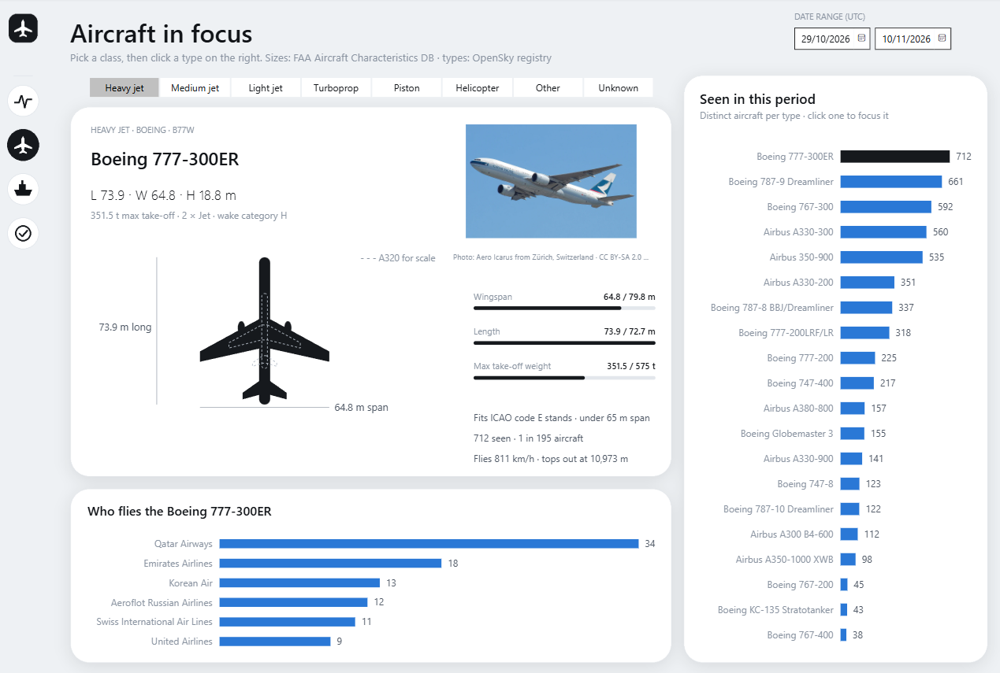
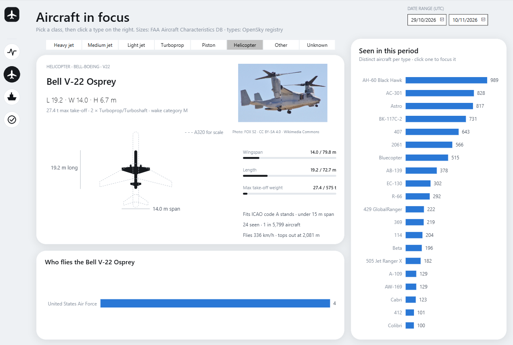
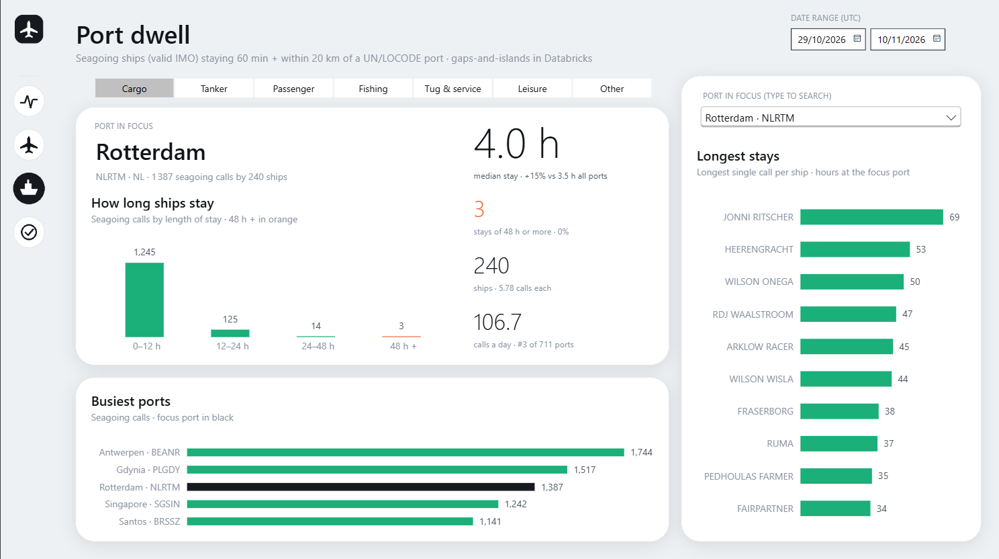
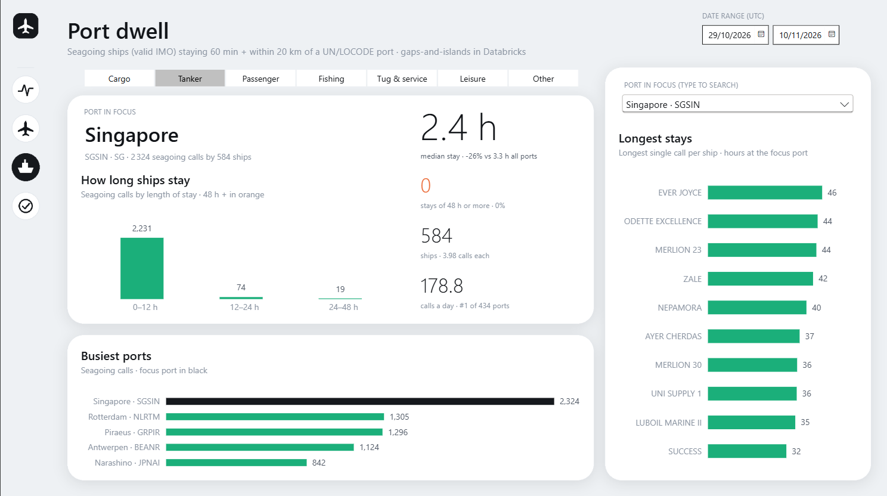
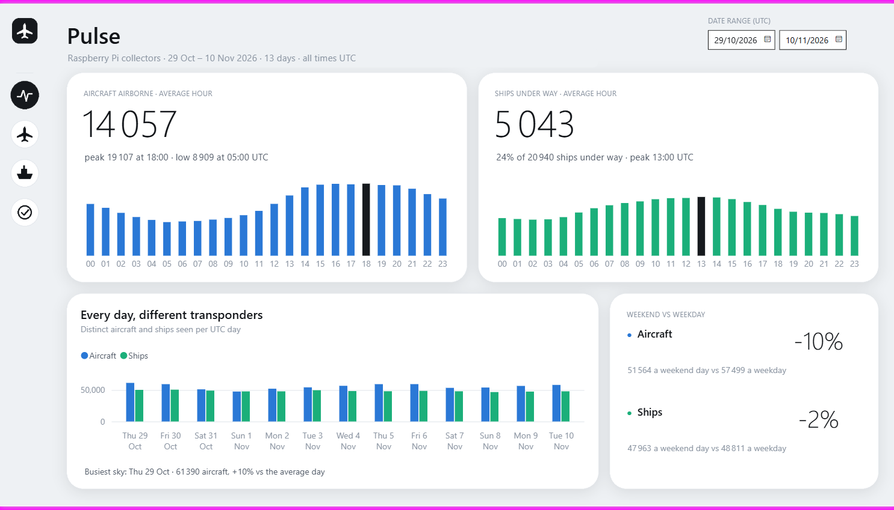
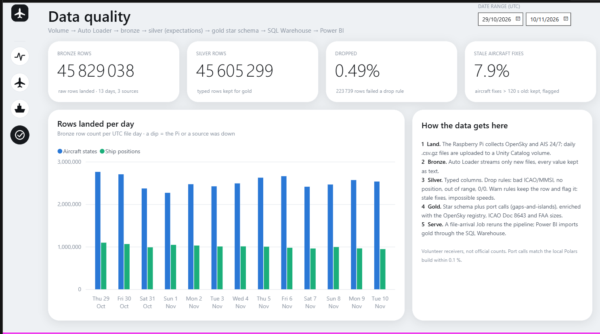

# Sky & Sea Lakehouse

Aircraft (OpenSky) and ship (AIS) positions collected 24/7 by my own Raspberry Pi. The data is processed into a gold star schema on **Databricks** and shown in a **Power BI** report.

Data window: 13 days, 29 Oct – 10 Nov 2026, 45.8 million bronze rows.

**3D explorer of the aircraft types:** https://vulevu228.github.io/SkySeaExplorer/



## Pipeline

```
Raspberry Pi collectors           Databricks                                        Power BI
OpenSky every 10 min    ──►  Unity Catalog volume ──► Auto Loader ──► bronze  ──►  SQL Warehouse ──► report
AIS 5-min windows            (daily .csv.gz)            Lakeflow pipeline: silver ─► gold star schema
                             file-arrival Job reruns the pipeline when a new day lands
```

- **Bronze:** streaming ingest, all strings, plus audit columns.
- **Silver:** typed values and data-quality expectations (bad coordinates, stale positions, impossible speeds). 0.49 % of rows are dropped.
- **Gold:** a star schema.
  - Dimensions: `dim_date`, `dim_aircraft`, `dim_aircraft_type`, `dim_ship`, `dim_port` and others.
  - Facts: `fact_aircraft_daily`, `fact_ship_daily`, `fact_traffic_hourly`, `fact_port_calls`, `fact_quality_daily`.
- **Enrichment:**
  - OpenSky aircraft registry (type, operator);
  - ICAO Doc 8643 (engines, wake category);
  - FAA Aircraft Characteristics Database (span, length, tail height, MTOW);
  - UN/LOCODE seaports.
- **Port calls:** a gaps-and-islands query. A port call is a ship stopped for 60 min or more within 20 km of a UN/LOCODE port. The Databricks result matches the local Polars build within 0.07 %.

## Power BI report

`powerbi/SkySeaDatabricks.pbip` connects to the Databricks SQL Warehouse. It has 4 pages: Pulse, Aircraft in focus, Port dwell and Data quality.

The report is generated by `powerbi_build/gen_pbip.py`, in a "product UI" style:
- designed backgrounds rendered with Pillow;
- transparent visuals placed on top;
- pill slicers;
- a to-scale SVG silhouette and size bars against the A380;
- a Wikimedia Commons photo of the aircraft type, with author and licence.

The aircraft page is a taller canvas (1280 × 860) instead of an extra page.

| | |
|---|---|
|  |  |
|  |  |



## Repo layout

| Path | What |
|---|---|
| `databricks/pipeline/skysea_pipeline.py` | Lakeflow Declarative Pipeline, bronze → silver → gold |
| `src/skysea/`, `scripts/`, `tests/` | the local Polars version of the same pipeline (bronze/silver/gold + Postgres load) |
| `sql/` | Postgres serving views |
| `powerbi/` | the Power BI project (PBIP: TMDL model + PBIR report) |
| `powerbi_build/` | report generator and Wikimedia Commons photo lookup |
| `web/` | DAX export of the model to JSON and the 3D explorer (published separately as SkySeaExplorer) |
| `archive/pyspark/` | the first PySpark version, before the move to Polars |

## Data & credits

OpenSky Network, AIS, FAA Aircraft Characteristics Database, ICAO Doc 8643, UN/LOCODE, Natural Earth. The aircraft photos come from Wikimedia Commons under free licences, and the author and licence are shown with each photo. These counts come from volunteer receiver networks, so they measure coverage, not official traffic statistics.

Connecting the report needs your own Databricks workspace and a personal access token, entered in Power BI Desktop's credential dialog. No credentials are stored in this repo.
